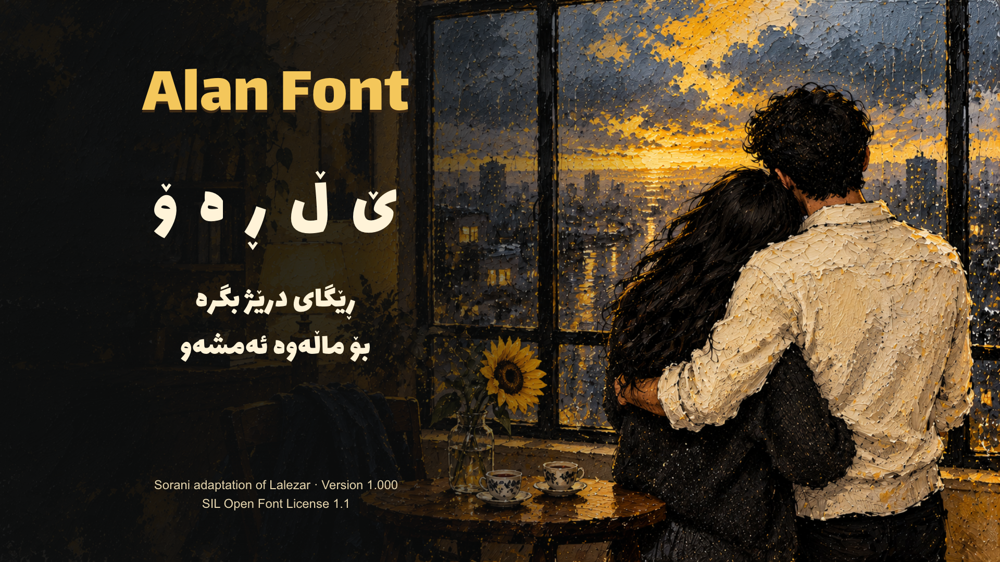
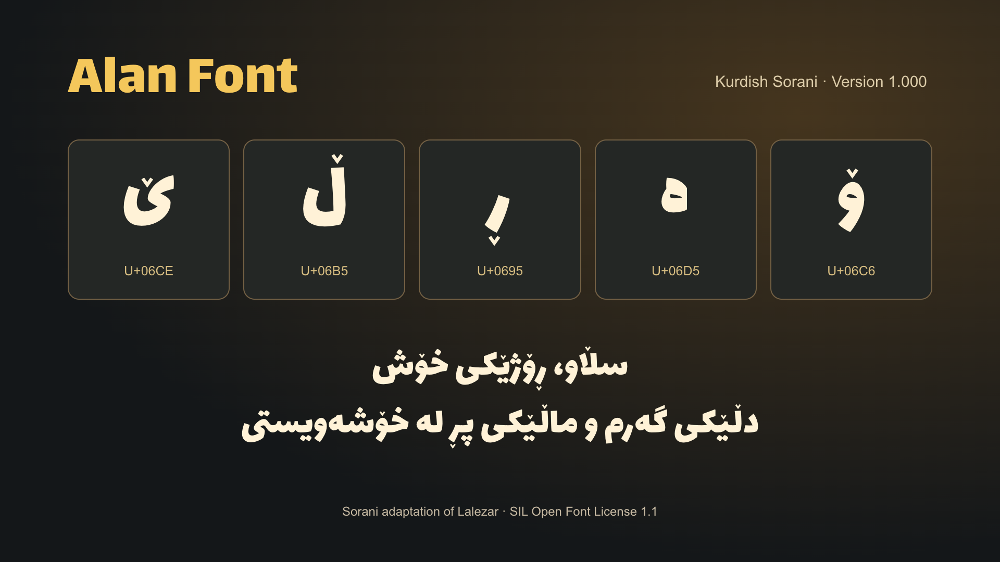

# Alan Font

A bold, playful display font with connected Kurdish Sorani lettering.





## Download

- [Desktop font — TTF](AlanFont-Regular.ttf)
- [Web font — WOFF2](AlanFont-Regular.woff2)
- [Full version 1.0 package, source and tests](Alan_Font_v1.0.zip)
- [Releases](https://github.com/elamredda-cmd/alan-font/releases)

To install, download the TTF, open it and choose your system’s **Install Font** option.

## Sorani support

This adaptation adds **ڕ ڵ ۆ ێ ە**, including the connected forms they need. It preserves the original font’s Latin, Arabic and Persian support. Right-to-left shaping, letter coverage and regression samples were checked with HarfBuzz and the font was visually reviewed in HyperFrames.

| Letter | Unicode |
|---|---|
| ڕ | U+0695 |
| ڵ | U+06B5 |
| ۆ | U+06C6 |
| ێ | U+06CE |
| ە | U+06D5 |

## Website use

```css
@font-face {
  font-family: "Alan Font";
  src: url("AlanFont-Regular.woff2") format("woff2");
  font-weight: 400;
  font-style: normal;
}
.sorani {
  font-family: "Alan Font", sans-serif;
  direction: rtl;
}
```

Use `lang="ckb"` and `dir="rtl"` on Sorani text. Keep the license with distributed font files.

## Credits and license

**Sorani adaptation: Alan Font project.** Alan Font is a modified version of **Lalezar**, originally designed by **Borna Izadpanah**.

Copyright 2015 The Lalezar Project Authors (https://github.com/BornaIz/Lalezar).

The font is available for personal and commercial use under the [SIL Open Font License 1.1](OFL.txt). Original copyright and license are included. This is a focused Sorani extension; the original authors do not endorse this adaptation.

Version **1.000**. See [provenance](PROVENANCE.json) and the source/tests in the release ZIP.
